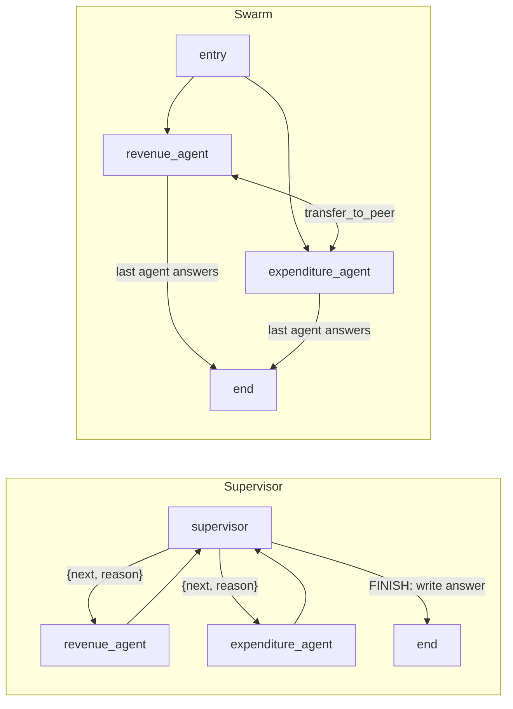

# Fiscal Document Agent

LLM extraction, tool calling and a multi-agent supervisor over one PDF: Singapore MOF's
"Analysis of Revenue and Expenditure, FY2024" (37 pages, in `data/`), the **Source Document**.

- **Part 1:** parse the PDF and extract five fields with one LLM call, each with page and quote
  evidence.
- **Part 2:** extract two dates, turn them into ISO dates with a tool on a local MCP server,
  then have an LLM classify each against 2024-01-01. Also implemented the same tool as an
  Agent Skill and compared token cost.
- **Part 3:** a LangGraph supervisor routing questions to a Revenue Agent and an Expenditure
  Agent, with a readable trace. Also built a swarm version of the same agents to compare.

Runs on Claude Sonnet 5.5 through AWS Bedrock by default; one environment variable switches
provider. Every live run's output and trace is committed in `outputs/`, so results can be
checked without an AI API key.

## Quick start

Needs Python 3.12 and [uv](https://docs.astral.sh/uv/).

```bash
uv sync          # install from uv.lock
uv run pytest    # 34 offline tests, no API key needed
```

The tests check the committed outputs against known answers, run each pipeline with a scripted
fake model, and test the plain functions (date parsing, search, sums, cost).

## Configuration

To rerun the LLM steps, copy `.env.example` to `.env` (git-ignored) and fill it in:

| Variable | Default | Meaning |
|---|---|---|
| `LLM_MODEL` | `bedrock_converse:global.anthropic.claude-sonnet-5-5` | `<provider>:<model id>` for LangChain's `init_chat_model` |
| `AWS_REGION` | `ap-southeast-1` | Bedrock region |
| `AWS_BEARER_TOKEN_BEDROCK` | empty | Bedrock API key |

### Other providers

Add the provider's LangChain package, set its key, and change `LLM_MODEL`. No code changes.

| Provider | Package | Key | `LLM_MODEL` |
|---|---|---|---|
| Anthropic | `langchain-anthropic` | `ANTHROPIC_API_KEY` | `anthropic:claude-sonnet-5-5` |
| Gemini | `langchain-google-genai` | `GOOGLE_API_KEY` | `google_genai:<model id>` |
| OpenAI | `langchain-openai` | `OPENAI_API_KEY` | `openai:<model id>` |
| Grok | `langchain-xai` | `XAI_API_KEY` | `xai:<model id>` |

Install with `uv add <package>`. Prices are only listed for Claude models, so other models show
cost as `n/a`.

## Running

Each script prints how many LLM calls it plans and asks before running (`--yes` skips the
question). Outputs go to `outputs/` as JSON plus a readable Markdown file.

| Part | Command | LLM calls |
|---|---|---|
| 1 | `uv run python scripts/part1_extract.py` | 1 |
| 2, MCP | `uv run python scripts/part2_mcp.py` | ~5 |
| 2, Skill + comparison | `uv run python scripts/part2_skill.py` | ~7 |
| 3, Supervisor | `uv run python scripts/part3_agents.py` | ~38 |
| 3, Swarm + comparison | `uv run python scripts/part3_compare.py` | ~28 |

Run each part's scripts in the order shown; the second one compares against the first one's
output.

## Evaluation

`uv run python scripts/evaluate.py --label "what changed"` compares the saved results in
`outputs/` with expected answers checked by hand against the Source Document (the Golden
Answers, in `evals/golden.json`). It makes no LLM calls. To check a change (prompt, model, tool
or graph), rerun that part's scripts, then this one, and compare the new line in
`evals/history.jsonl` with earlier ones. `-v` lists the checks that failed.

Only what the assignment asks for is scored:

- **Part 1:** the five fields (numbers must match exactly), the cited page for the four number
  fields, and the tax list (taxes that must and must not appear).
- **Part 2:** the status of the two document dates, for both the MCP and the Skill version. A
  date that is not in the document counts as a failed check.
- **Part 3:** the assignment's query, for both the Supervisor and the Swarm graph: the answer
  must mention the facts listed in `evals/golden.json`. The extra example dates and queries
  are not scored.

Baseline on the committed outputs:

| Suite | Checks passed |
|---|---|
| part1 | 20/20 |
| part2_mcp | 2/2 |
| part2_skill | 2/2 |
| part3_supervisor | 5/5 |
| part3_swarm | 5/5 |

This is a simple evaluation: exact values for Part 1 and Part 2, and a list of facts the Part 3
answer must mention. It checks that each fact appears, not whether the answer is complete or
well argued, and a correct answer worded differently (for example "$5,000 million" instead of
"$5 billion") would fail. More thorough options include:

- **Semantic similarity:** compare the answer with a reference answer by meaning (embeddings),
  so different wording of the same fact still passes.
- **LLM as a judge:** a second model grades each answer against the Source Document or a
  reference answer, using a rubric (correct figures, all parts of the question covered, no
  unsupported claims). This costs LLM calls, and the judge's grades would need spot checks
  of their own.
- **More test questions:** more queries with checked answers, scored over several
  runs, since LLM output varies between runs.

## Design

```
src/fiscal_doc_agent/
  parsing.py      PDF -> one Markdown record per page, cached in .cache/
  llm.py          model from LLM_MODEL; USD cost from token usage
  extraction.py   extract(pages, schema, model) and the Part 1 / Part 2 schemas
  dates.py        normalize_dates: text -> ISO dates (plain Python, no LLM)
  mcp_server.py   local stdio MCP server exposing normalize_dates
  part2.py        run_part2(arm, model): extract, normalise and classify dates
  part3.py        document tools, the two agents, the Supervisor and Swarm graphs
skills/normalize-dates/   the Agent Skill version of normalize_dates
scripts/                  one script per part, plus evaluate.py
evals/                    Golden Answers and the history of Eval Runs
```

### Part 1: parsing and extraction

Parsed with **pymupdf4llm**. The PDF has a real text layer and the answers sit in tables, so
the parser must keep table rows intact and page numbers for evidence. pymupdf4llm outputs
Markdown tables page by page, runs locally in seconds, and needs no models or cloud calls.

- **Textract** is built for scanned documents (OCR). Nothing here needs OCR, and it adds a paid
  cloud call per page. The better choice for scanned PDFs.
- **Docling** has strong table models but pulls in PyTorch and model downloads, and is slow on
  CPU. Overkill for 37 clean pages.
- **pdfplumber** extracts tables precisely but needs settings tuned per table and has no
  Markdown output, so reading order would need rebuilding by hand.

Extraction is one LLM call with the whole document (~33K tokens), each page wrapped in a
`<page n="...">` marker, returning a typed Pydantic schema. The page hints in the assignment are
not given to the model. The field descriptions carry the prompt engineering: which table,
column, year and unit to use (e.g. "the Estimated FY2024 column", "(3.5) means -3.5"). Each
field comes back with its value as printed, its unit, and evidence (page + verbatim quote).
Code, not the LLM, converts $million to $billion.

### Part 2: date tool and classification

1. The same `extract` function pulls the two date phrases with a small dates schema.
2. An agent calls `normalize_dates`, plain Python that returns every full date in each text as
   `YYYY-MM-DD`, so the LLM never writes a date itself.
3. The agent classifies each date using rules in its prompt and submits the records through a
   tool that checks them against what `normalize_dates` returned.

**python-dateutil.** `normalize_dates` first finds full dates (day, month and year) with a
regular expression, then hands each match to `dateutil.parser.parse(..., dayfirst=True)`. It
reads month names and abbreviations ("16 February 2024", "16 Feb 2024", "Sept.") and day-first
numbers ("16/02/2024", as written in Singapore) without a hand-written format list. Partial dates
such as "FY2023" or "February 2024" are left out on purpose.

**MCP vs Skill.** The tool is delivered two ways on the same `deepagents` agent:

- **MCP:** a local stdio MCP server; the tool is available from the first turn.
- **Skill:** `skills/normalize-dates/SKILL.md`; the agent only sees the skill's name and
  description until it reads the file, and only then gets the tool.

### Part 3: agents and graphs

Both agents search the document with **BM25** (`search_document`), then read the pages they
need (`read_page`). The Expenditure Agent also has `sum_amounts`, so totals are exact. The
agents are defined once and shared by both graphs, so the only difference is how they are
connected.

**BM25.** `search_document` ranks pages with BM25, a classic keyword-search score (`rank-bm25`).
A page scores higher when it contains more of the query's words, rarer words count for more
("Future Energy Fund" outweighs "the" or "FY2024"), repeating a word helps less each time, and
long pages are not favoured just for being long. The agent gets the top pages with a short
snippet, then reads only those. For 37 pages of fiscal text, where questions use the document's
own terms ("Top-up", "Corporate Income Tax"), keyword search finds the right pages without
embeddings, a vector store or extra API calls.



- **Supervisor** (the assignment's deliverable): each turn, one LLM call returns
  `{next agent or FINISH, reason}` and LangGraph's `Command` sends the question there. The reason
  becomes the agent's task and goes into the trace. On FINISH the supervisor writes the final
  answer from all findings.
- **Swarm** (for comparison): one call picks the first agent; agents hand off to each other
  directly with a `transfer_to_<peer>` tool, and the last one writes the answer.

**Hand-built graphs.** LangChain has `langgraph-supervisor` (now archived) and
`langgraph-swarm`. Each graph here is a few dozen lines of plain `StateGraph` and `Command`
(what those packages use underneath), and both share one state and trace format, so the
comparison measures the wiring and not two libraries' defaults.

**Routing instead of agents-as-tools.** A common alternative makes the supervisor a chat agent
that calls each sub-agent as a tool, in one growing conversation. Here the supervisor is a
router: each step it reads a short summary (question + findings so far) and returns
`{next, reason}`.

- **Trace:** every hop is a recorded decision with a reason.
- **Context:** the supervisor's input stays small because it gets a fresh summary each step
  instead of a growing conversation. Downside: it only sees summaries, never the pages
  themselves.
- **Speed:** agents run one after another; an agents-as-tools supervisor can call both at once.

## API

The main Python functions. Each LLM step takes the model as an argument, so the scripts pass
the real model and the tests pass a fake one.

| Function | Returns |
|---|---|
| `parsing.load_pages()` | `[{page, markdown}]`, one per page |
| `extraction.extract(pages, schema, model)` | the filled-in `schema`, each field with page + quote evidence |
| `dates.normalize_dates(texts)` | one list of `YYYY-MM-DD` dates per text (also served by the MCP server) |
| `part2.run_part2(arm, model)` (async) | `{records, mentions, usage}`; `arm` is `"mcp"` or `"skill"` |
| `part3.run_graph(kind, query, model)` | `{answer, trace, usage, llm_calls, latency_s}`; `kind` is `"supervisor"` or `"swarm"` |

## Results

Single runs on Sonnet 5.5, prices as of 2026-11-05.

### Part 1 ([outputs/part1_extraction.md](outputs/part1_extraction.md))

| Field | Value | Page |
|---|---|---|
| Corporate Income Tax 2024 ($billion) | 28.03 | 16 |
| YoY % change of Corporate Income Tax | -1.2 | 16 |
| Total Top-ups 2024 ($billion) | 20.352 (printed as 20,352 $million) | 20 |
| Taxes in "Operating Revenue" | Corporate Income Tax, Other Taxes, Personal Income Tax, Assets Taxes, Betting Taxes, Goods and Services Tax, Foreign Worker Levy, Water Conservation Tax, Land Betterment Charge, Annual Tonnage Tax, Casino Taxes | 5-6 |
| Latest Actual Fiscal Position ($billion) | 1.72 (FY2022) | 8 |

### Part 2 ([outputs/part2_mcp.md](outputs/part2_mcp.md))

```json
[
  {"original_text": "Distributed on Budget Day: 16 February 2024", "normalized_date": "2024-02-16", "status": "Upcoming"},
  {"original_text": "15 February 2008", "normalized_date": "2008-02-15", "status": "Expired"}
]
```

Each record also has a `reasoning` field. Since neither document date is a period, a short demo
classifies three financial years (FY2022 Expired, FY2023 Ongoing, FY2024 Upcoming) to show all
three states.

**MCP vs Skill** ([outputs/part2_comparison.md](outputs/part2_comparison.md)), agent stage only:

| | Input tokens | Output tokens | USD |
|---|---|---|---|
| MCP | 3,881 | 347 | 0.0086 |
| Skill | 8,609 | 423 | 0.0185 |

The Skill version used about twice the input tokens. A skill saves context by hiding a tool
until it is needed, but here there is one small tool and the agent always needs it. So the
skill only adds cost: the skill instructions in every system prompt, and an extra turn to read
`SKILL.md`. Skills would be better when an agent has many tools it rarely uses.

### Supervisor vs Swarm ([outputs/part3_comparison.md](outputs/part3_comparison.md))

Traces: [supervisor](outputs/part3_supervisor.md), [swarm](outputs/part3_swarm.md).

| Query | Graph | Agents | LLM calls | Tokens in / out | USD | Seconds |
|---|---|---|---|---|---|---|
| Q1: key revenue streams + Future Energy Fund | supervisor | revenue > expenditure | 13 | 56,185 / 6,158 | 0.1739 | 48.8 |
| | swarm | revenue > expenditure | 7 | 19,648 / 2,612 | 0.0654 | 22.7 |
| Q2: fastest-growing revenue streams | supervisor | revenue | 6 | 11,689 / 2,410 | 0.0475 | 19.2 |
| | swarm | revenue | 4 | 7,984 / 1,285 | 0.0288 | 12.2 |
| Q3: total fund Top-ups, largest one | supervisor | expenditure | 7 | 12,943 / 1,479 | 0.0407 | 14.4 |
| | swarm | expenditure | 5 | 8,595 / 578 | 0.0230 | 7.6 |
| Q4: does the GST increase cover the GST Voucher Top-up? | supervisor | revenue > expenditure | 11 | 32,794 / 3,276 | 0.0983 | 30.4 |
| | swarm | revenue > expenditure | 8 | 26,038 / 1,441 | 0.0665 | 16.6 |

Both graphs routed every query to the right agents. Both main-query answers list the key
revenue streams with figures and say the Future Energy Fund is supported by an initial
$5.0 billion Top-up in FY2024.

The swarm used about half the tokens, cost and time. The supervisor makes extra central calls
(one route per agent run, a FINISH and a final write-up), each re-sending all findings so far.
In the swarm the last agent writes the answer in the turn it would have used to report back.

In general, a supervisor suits tasks with many agents, routing that needs judgement, or an
answer that must be checked and combined in one place. A swarm suits a few agents with clear
specialisms that can pass work to each other, where lower cost and latency matter more.

## Assumptions

- **Part 2 dates.** The assignment says to normalise "dates extracted in Part 1", but Part 1's
  five fields did not include a date. Part 1's extraction code is reused with a separate dates
  schema, so Part 1's output stays the five fields.
- **"2024" means FY2024** (April 2024 to March 2025), whose only figures are the Estimated
  FY2024 column.
- **Money in $billion.** Top-ups are printed in $million; converted to $billion so every money
  field shares one unit.
- **Tax list.** Taxes named in the section text plus the named parts of Other Taxes (Foreign
  Worker Levy, etc.); non-tax revenue such as Vehicle Quota Premiums is left out.
- **Cut-off dates.** "Estate Duty does not apply to a person who dies after 15 February 2008"
  marks a rule still in force. Classified by the date itself (Expired), with the reasoning
  noting the rule still applies; Ongoing is kept for periods, as the assignment defines it.
- **Part 3 query.** "Key revenue streams" means the largest Operating Revenue items, with
  figures. "How the Future Energy Fund is supported" means its funding in the FY2024 Budget
  (the $5.0 billion Top-up) and what it pays for.

## Libraries

| Library | Why |
|---|---|
| `pymupdf4llm` | PDF to page-by-page Markdown with tables (see Part 1) |
| `langchain`, `langchain-core` | one interface for every LLM provider, structured output, agents, token usage |
| `langchain-aws` | Claude on Bedrock |
| `langgraph` | the graphs; `Command` picks the next node and updates state in one step |
| `deepagents` | the Part 2 agent; has Agent Skills built in, so MCP and Skill run on the same agent |
| `mcp`, `langchain-mcp-adapters` | the MCP server, and turning its tool into a LangChain tool |
| `rank-bm25` | keyword search over 37 pages, no embeddings or vector store needed |
| `python-dateutil` | parsing dates written in words |
| `pydantic` | typed schemas the model fills in |
| `python-dotenv`, `botocore` | `.env` loading; a longer Bedrock timeout as a safety margin for the whole-document call |

## Limits

- One run per comparison, to keep cost low, so exact numbers could move a little between runs.
- No OCR: the PDF has a text layer. Scanned PDFs would need an OCR parser such as Textract.
- No conversation memory: each question is answered on its own.
